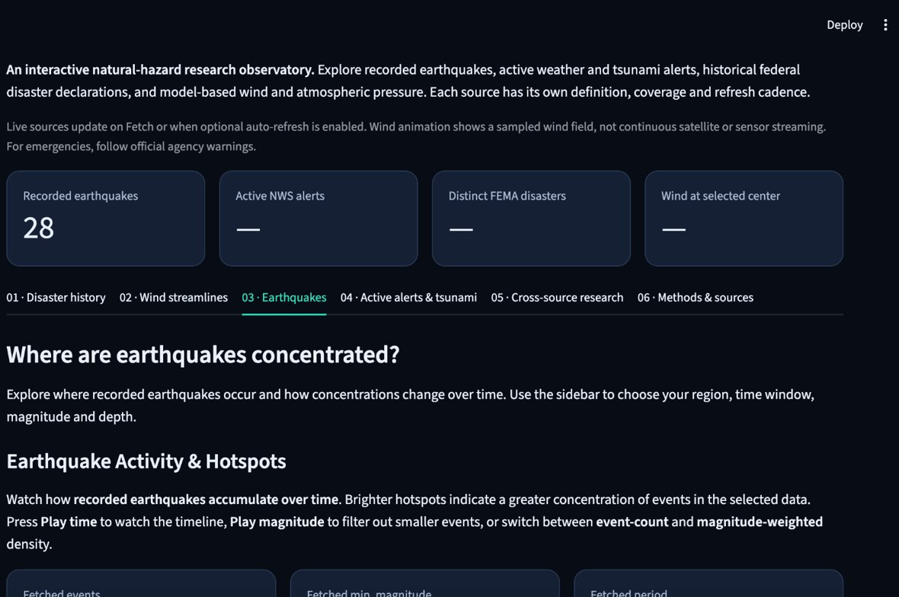
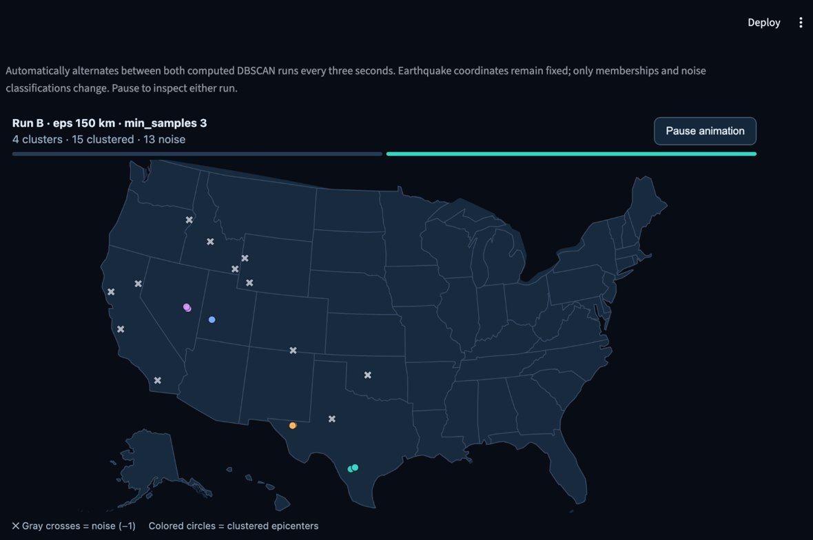
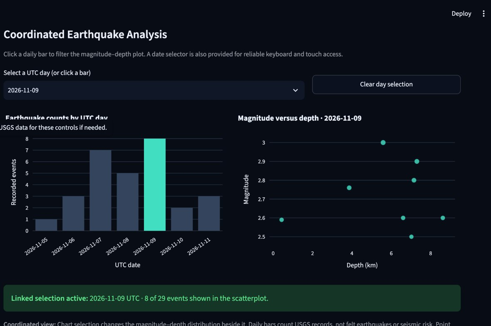
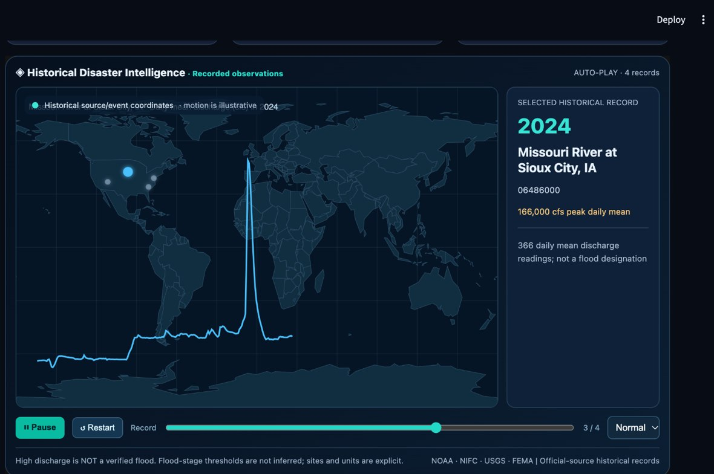
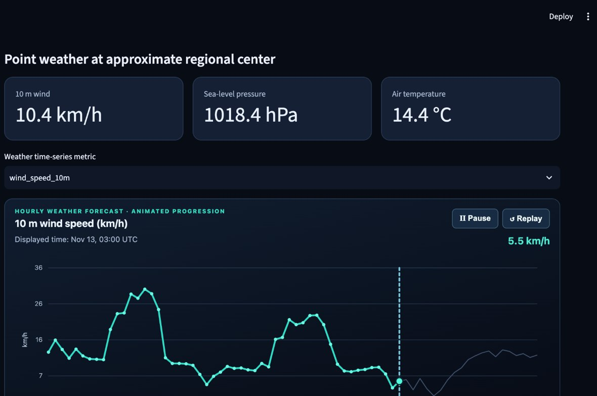
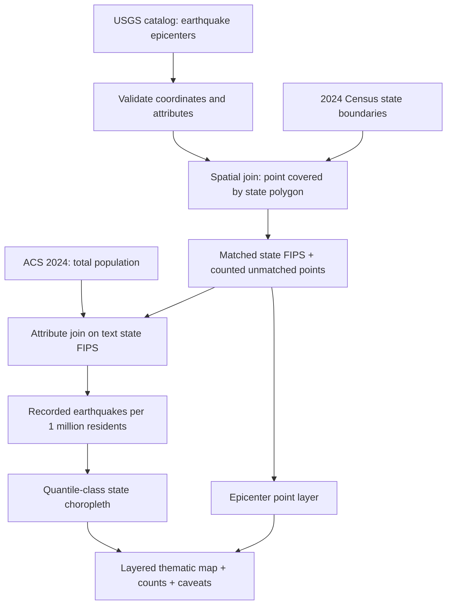
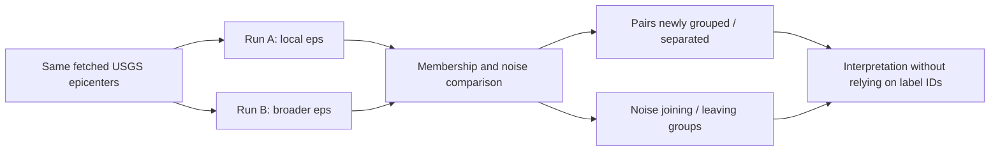

<div align="center">

# ◈ HazardScope USA

### An interactive natural-hazard intelligence observatory

**From earthquake epicenters to atmospheric motion—explore what official data shows, how geography changes the analysis, and where interpretation must stop.**

[](https://github.com/nazishatta/hazardscope-usa)
[](https://hazardscope-usa.streamlit.app/)
[](#run-locally)


[**🚀 Open live dashboard**](https://hazardscope-usa.streamlit.app/) · [**Explore the workspaces**](#explore-the-six-workspaces) · [**Geographic methodology**](#the-geographic-analysis) · [**Interactive bonuses**](#coordinated-views--dbscan) · [**Data provenance**](#official-data-sources--freshness) · [**Deploy**](#deployment)

</div>

---

## The research question

> **How can recorded U.S. hazards, active warnings, geographic context, and model-derived atmospheric conditions be explored together—without mistaking event counts, data-density patterns, or visual animations for physical risk?**

HazardScope USA is a **six-workspace Streamlit application** built around a reproducible geographic study of **USGS earthquake points**. It joins recorded epicenters to **2024 Census state boundaries**, merges **2024 ACS population** using state FIPS codes, and visualizes **earthquake events per million residents**. It also explores selected official hazard histories, active NWS warnings, and Open-Meteo weather-model outputs.

The animations are exploratory views of **retrieved records or sampled model fields**. They are **not** emergency forecasts, continuously tracked physical objects, or calibrated hazard-risk maps.

### Project at a glance

| Dimension | Implementation |
|:--|:--|
| **Primary assignment dataset** | USGS earthquake epicenters, fetched for the selected region, dates, magnitude and depth |
| **Geographic regions** | U.S. Census 2024 state/state-equivalent polygons |
| **External denominator** | ACS 2024 one-year total population (`B01003_001E`) |
| **Regional identifier** | Text-preserved state `GEOID` / FIPS, including leading zeroes |
| **Layered thematic map** | Population-normalized state choropleth + individual earthquake epicenters |
| **Spatial operation** | True point-in-polygon `covers(point)` join; unmatched observations counted |
| **Classification / projection** | Quantiles (up to five observed classes; duplicate breaks collapsed) / Albers USA |
| **Coordinated interaction** | Selecting a UTC-day bar filters the magnitude–depth scatterplot |
| **Spatial clustering** | DBSCAN with haversine neighborhoods, visible noise, two-`eps` sensitivity comparison |
| **Interface** | Six tabs, shared state/region sidebar, optional refresh and downloadable data |
| **Sources** | USGS, U.S. Census Bureau, NOAA/NCEI/NHC, NWS, FEMA, Open-Meteo |

**Data are fetched on demand.** Totals vary with time, region and thresholds. No example event counts are hard-coded as project-wide findings.

---

## A tour of the observatory

The images below are **cropped screenshots of actual local HazardScope sessions**. They illustrate the interface; they are not a replacement for the interactive dashboard or evidence that the public deployment is live.

<table>
<tr>
<td width="50%" valign="top"><a href="docs/assets/earthquake-density.jpg"></a><br><strong>Seismic density</strong><br><sub>Recorded epicenters build into geographic concentration patterns.</sub></td>
<td width="50%" valign="top"><a href="docs/assets/dbscan.jpg"></a><br><strong>DBSCAN clustering</strong><br><sub>Compare geographic neighborhoods while retaining unclustered noise points.</sub></td>
</tr>
<tr>
<td valign="top"><a href="docs/assets/coordinated.jpg"></a><br><strong>Coordinated analysis</strong><br><sub>Select a day to update a second chart from the same USGS records.</sub></td>
<td valign="top"><a href="docs/assets/windflow.jpg"></a><br><strong>WindFlow</strong><br><sub>Illustrative particles move through a sampled wind-vector field.</sub></td>
</tr>
<tr><td colspan="2" valign="top"><a href="docs/assets/forecast.jpg"></a><br><strong>Hourly weather-model forecast</strong><br><sub>Playback walks through hourly model values; it does not imply live measured weather movement.</sub></td></tr>
</table>

> **Screenshots are snapshots, not fixed results.** The values shown can differ after refresh, changing filters, or retrieving a new forecast.

## Explore the six workspaces

| Workspace | Core question | What to explore |
|:--|:--|:--|
| **01 · Disaster history** | What do the historical records show? | Hurricanes/tropical storms, historical tsunami origins, wildfire perimeters, river discharge stations, FEMA declarations; source-specific animation and caveats |
| **02 · Wind streamlines** | How is the sampled model wind field oriented? | WindFlow paths, sampled wind-speed surface, pressure/forecast grids, resolution and particle controls |
| **03 · Earthquakes** | Where and when were earthquakes recorded? | Animated seismic density, layered Census choropleth, both joins, coordinated views and DBSCAN |
| **04 · Active alerts & tsunami** | Which official NWS alerts are active in the fetched snapshot? | Supplied warning/zone polygons, severity and urgency, expiration timeline and selected-alert details |
| **05 · Cross-source research** | How can different sources be compared responsibly? | Source counts with separate meanings; point-weather model forecasts and their interpretation |
| **06 · Methods & sources** | What generated each claim? | Source provenance, refresh status and limitations |

<details>
<summary><strong>▶ Guided demonstration: five minutes with HazardScope</strong></summary>

1. **Begin with the source definitions.** In *Disaster history*, inspect one animation and read its coverage caption before inferring anything about impact.
2. **Set the primary dataset.** Choose **United States**, a USGS date window and magnitude/depth limits in the shared sidebar, then fetch earthquake events.
3. **Read the thematic map.** In *Earthquakes*, inspect the Census choropleth and epicenter layer. Record matched, unmatched and missing-denominator counts.
4. **Demonstrate coordination.** In *Coordinated Earthquake Analysis*, click a UTC-day bar (or use the day selector). The magnitude–depth scatterplot should refilter. Clear the selection to recover the full dataset.
5. **Demonstrate sensitivity.** Use **Jump to DBSCAN Clustering** under the state selector. Compare two neighborhood radii, note `min_samples`, and inspect changes in noise and actual group memberships.
6. **Check the interpretation.** Read the captions: a high event count or density is not a predicted earthquake hazard or risk score.

</details>

---

## The geographic analysis

The core assignment uses **one point dataset** and two explicit joins. USGS bounding boxes define the **API query footprint**; they are **not** substitutes for the later Census point-in-polygon join.



### 1 · Spatial join: which region contains each point?

USGS coordinates are tested against **2024 Census state-equivalent polygons** with Shapely's `covers(point)` predicate. This includes points on polygon boundaries. A point may remain unmatched because it is **offshore, outside the supplied polygons, or invalid**. The app exposes matched/unmatched totals and the reasons for unassigned records; unmatched epicenters are **not silently assigned to the nearest state**.

### 2 · Attribute join: what is the regional denominator?

State counts are joined to **2024 ACS one-year total population** (`B01003_001E`) using a **two-character text FIPS key**. Text keys preserve leading zeroes such as `01`; absent or invalid denominators are not replaced with zero.

$$
\text{Recorded events per million residents}=\frac{\text{Matched USGS events in state}}{\text{ACS state population}}\times 1{,}000{,}000
$$

The result is a **descriptive normalization over a selected reporting window**, *not* a probability of an earthquake affecting a resident. National queries cover an approximate contiguous-U.S. bounding box; unqueried Alaska, Hawaii and territories are not interpreted as zero-event regions.

### 3 · Map design and reading rules

| Element | Encoding / safeguard |
|:--|:--|
| **Polygon fill** | Selected state-level recorded-event rate or raw event count |
| **Classification** | Quantile breaks, at most five observed classes; duplicate breaks collapse rather than inventing distinctions |
| **Point overlay** | USGS epicenter locations; symbol size reflects magnitude |
| **Projection** | Albers USA for the U.S. polygon/epicenter views |
| **Exclusions** | Unmatched points counted; unqueried regions identified; query caps/coverage limits disclosed |
| **Source vintage** | Census polygons 2024 and ACS population 2024 |
| **Data export** | Joined regional table and fetched earthquake records available in the app |

<details>
<summary><strong>▶ Why a low-color choropleth can be correct</strong></summary>

For short windows or high magnitude thresholds, very few states may have recorded events. Equal values must not be artificially split into different color classes. The implementation reports the **actual number of observed classes**, which can be fewer than five. Broader date windows may be more informative, but also change the population of records being analyzed.

</details>

---

## Coordinated views & DBSCAN

These are two **independent optional bonus routes** for the geographic assignment. HazardScope implements both; they are not simply decorative animations.

### Coordinated earthquake analysis

**User action:** select a **UTC day** in the daily earthquake bar chart (or through the day selector).  
**Linked result:** the adjacent **magnitude-versus-depth scatterplot** filters to that day's recorded events; clearing the selection restores the full fetched population.

This is a **selection-to-data-filter interaction**, distinct from a playback animation. A newly retrieved dataset should be interpreted with its own filter state.

### DBSCAN: compare neighborhoods, not cluster numbers

DBSCAN runs on **the fetched epicenter coordinates** with **haversine distance**. Latitude and longitude are converted to radians before clustering, and `eps` is expressed to users in kilometers.

| Control | What it means |
|:--|:--|
| `eps` | Maximum neighborhood distance for density connectivity, in kilometers |
| `min_samples` | Minimum number of observations in a neighborhood for a core point, **including the point itself** |
| Noise `−1` | Valid epicenters that do not join a dense group at the selected settings; counted and rendered distinctly |
| Run A / Run B | Different `eps` values applied to the **same fetched observations**, with the same `min_samples` |

**Parameter rationale.** The default local radius (75 km) and `min_samples = 3` are **exploratory choices** for geographically local concentrations, not geologic fault-zone thresholds. A broader comparison radius tests whether neighboring points become connected or whether noise points join groups. Users can change the values in the app.

The animated comparison keeps the earthquake coordinates **fixed**. It alternates between *calculated classifications*, reports clusters and noise for each run, and compares **actual co-clustered point pairs and noise transitions**—**not** Cluster 1 in Run A to Cluster 1 in Run B, because label numbers are arbitrary.



<details>
<summary><strong>▶ Interpreting animation, cluster envelopes and noise</strong></summary>

- **Animation:** switches between parameter settings; the earth does not move, and the display does not forecast future earthquakes.
- **Translucent envelopes:** draw around observed cluster point extents; they do **not** represent official fault lines, an `eps`-radius coverage area, or hazard boundaries.
- **Noise (`−1`):** retained observations, not an algorithm failure or invalid data. Both count and share matter.
- **Sensitivity:** cluster totals may stay constant while memberships change. If both runs identify identical memberships, that is a valid finding and should be reported as such.
- **Sampling:** API caps, a narrow time window, and magnitude/depth thresholds can materially change the clusters.

</details>

---

## Official data sources & freshness

| Provider | Used for | Interpretation and limitations |
|:--|:--|:--|
| [USGS Earthquake Catalog](https://earthquake.usgs.gov/fdsnws/event/1/) | Reported earthquake coordinates, time, magnitude and depth | Recorded catalog events for the fetched query; bounding rectangles can cross state or national boundaries |
| [U.S. Census Bureau](https://www.census.gov/geographies/mapping-files/time-series/geo/carto-boundary-file.html) | 2024 state boundaries | Geography for actual point-in-polygon assignment; generalized cartographic polygons |
| [ACS API](https://api.census.gov/data/2024/acs/acs1.html) | 2024 one-year total population | External denominator; requires matching geography and valid population values |
| [NWS Alerts API](https://www.weather.gov/documentation/services-web-api) | Active alerts and official alert/zone geometry | Alerts are administrative warnings, not physical event counts or predicted storm tracks |
| [NOAA NHC](https://www.nhc.noaa.gov/data/) | Recorded hurricane best-track histories | Six-hourly fixes; connecting them is not a new observation or proof of damage |
| [NOAA/NCEI Tsunamis](https://www.ncei.noaa.gov/products/natural-hazards/tsunamis-earthquakes-volcanoes/tsunamis) | Historical tsunami source events | Source origins are not affected-coast measurements or modeled wave propagation |
| [NIFC WFIGS](https://data-nifc.opendata.arcgis.com/) | Historical wildfire perimeters | Geometry-derived display points are not exact ignition locations |
| [USGS Water Services](https://waterservices.usgs.gov/) | Selected station discharge histories | Discharge is not equivalent to a confirmed flood; station sample is not nationwide coverage |
| [OpenFEMA](https://www.fema.gov/api/open/v2/DisasterDeclarationsSummaries) | Disaster declaration records | Administrative records; deduplication, source limits and incomplete retrieval matter |
| [Open-Meteo](https://open-meteo.com/en/docs) | Sampled wind field, point weather and hourly forecasts | Model-derived estimates and forecasts, not individual sensor readings |

### What “live” means here

- **On-demand retrieval:** source data are fetched by explicit controls; some sources can be rechecked by optional auto-refresh while the browser session is connected.
- **Caching:** recent requests may be reused for short intervals. The app shows fetch metadata and warns about stale filter combinations.
- **Historical playback:** accelerated presentation of records, not real-time hazard motion.
- **WindFlow:** particles are numerically advected through one sampled model wind field; they are not physical tracked air parcels.
- **Weather animation:** compressed playback across *forecast hours*, not weather happening in accelerated real time.
- **Emergency use:** consult official agencies. An absence of an alert in a fetched snapshot does not prove safety.

---

## Run locally

**Prerequisites:** Python 3.11+ (local development was exercised with Python 3.13), Git, internet access for official source retrieval, and a supported browser. The application uses Streamlit, Plotly, NumPy/Pandas, SciPy, scikit-learn, Shapely and PyShp.

```bash
git clone https://github.com/nazishatta/hazardscope-usa.git
cd hazardscope-usa
python3 -m venv .venv
source .venv/bin/activate
python -m pip install -r requirements.txt
python -m streamlit run app.py
```

Open the local URL printed by Streamlit (typically `http://localhost:8501`).

<details>
<summary><strong>▶ Windows (PowerShell)</strong></summary>

```powershell
git clone https://github.com/nazishatta/hazardscope-usa.git
cd hazardscope-usa
py -3 -m venv .venv
.venv\Scripts\Activate.ps1
python -m pip install -r requirements.txt
python -m streamlit run app.py
```

</details>

<details>
<summary><strong>▶ Census population key and local configuration</strong></summary>

The Census population acquisition module reads **`CENSUS_API_KEY`** from Streamlit secrets or the server environment when the ACS cache is missing. Configure it locally in `.streamlit/secrets.toml`:

```toml
CENSUS_API_KEY = "YOUR_CENSUS_API_KEY"
```

This key must **not** be committed to GitHub. Public visitors should never have to enter a credential. The code attempts to load the official boundary and population resources on the server. An internet connection and reachable Census services are required when uncached.

The source caches under `data/seismic_geography/` are local outputs, not bundled fixed study results.

</details>

### Tests and reproducibility

```bash
python -m py_compile app.py
python -m compileall -q src
python -m pytest -q
```

**Scope of validation:** the project contains automated Python tests, but a passing unit-test run alone does **not** certify live API access, working browser selection, every historical endpoint, or a clean cloud deployment. Verify these separately, with the same commit and configuration you intend to publish.

<details>
<summary><strong>▶ Acceptance checks for an academic presentation</strong></summary>

- [ ] The app loads in a clean browser session and the data-fetch buttons operate.
- [ ] State/region sidebar selection affects more than one workspace.
- [ ] The choropleth includes polygons **and** epicenter points; its rate, classes and projection are stated.
- [ ] Both joins are displayed, including spatially unmatched events and missing population joins.
- [ ] Clicking a UTC-day bar refilters the scatterplot; clearing restores the full set.
- [ ] DBSCAN shows `eps`, `min_samples`, retained noise and two-run, label-invariant comparison.
- [ ] Every map has a nearby caption explaining encoding, parameters, coverage and exclusions.
- [ ] Historical/forecast animations do not imply causal hazard prediction or physical motion.
- [ ] The public URL works independently of localhost and server-side Census credentials are configured.

</details>

## Project structure

<details open>
<summary><strong>▶ Core repository modules</strong></summary>

```text
hazardscope-usa/
├── app.py                         # Six-tab Streamlit application and shared controls
├── src/
│   ├── providers.py               # USGS, NWS, FEMA and weather-source clients
│   ├── geo.py                     # Region metadata and query footprints
│   ├── seismic_geography.py       # Census polygons, ACS FIPS join, thematic map
│   ├── seismic_animation.py       # Earthquake animation integration
│   ├── quake_bonus.py             # Coordinated charts and DBSCAN controls
│   ├── dbscan_motion.py           # Animated two-radius clustering comparison
│   ├── alert_intelligence.py      # Active warning and polygon analysis
│   ├── disaster_history_intelligence.py  # Five historical disaster explorers
│   ├── wind_canvas.py             # WindFlow particle animation
│   ├── wind_surface.py            # Smoothed sampled wind-speed surface
│   └── weather_timeline_animation.py  # Animated hourly forecast
├── docs/
│   └── assets/                    # README screenshots from local application
├── tests/                         # Automated validation
├── .streamlit/
│   └── config.toml                # Streamlit visual configuration
├── requirements.txt
├── .gitignore
└── README.md
```

Additional helper modules, embedded HTML renderers and geographic source assets live under `src/`. External data caches and local secrets are not part of the committed evidence.

</details>

---

## Deployment

**Public application:** [**Launch HazardScope USA on Streamlit Community Cloud**](https://hazardscope-usa.streamlit.app/)  
**Source repository:** [github.com/nazishatta/hazardscope-usa](https://github.com/nazishatta/hazardscope-usa)

The dashboard is hosted from the repository's `main` branch with `app.py` as its entrypoint. The live URL is included above; **public runtime verification is separate from the existence of the URL**. Before submitting the project, open the link in a private browser window and check each of the following:

1. The application loads without a Python error and the six tabs are accessible.
2. USGS earthquakes load and the Census polygon and ACS population joins render.
3. Clicking a UTC day in the coordinated chart refilters the scatterplot; Clear restores all observations.
4. DBSCAN quick access, clustering animation, noise counts, and two-radius sensitivity comparison work.
5. NWS, historical-disaster, WindFlow, and weather views load when requested.
6. `CENSUS_API_KEY` is configured in the Streamlit app **Secrets**, not in Git, and `requirements.txt` includes the needed packages.

Manage deployment and server-side secrets at [Streamlit Community Cloud](https://share.streamlit.io/).

For the GWU Week 9–10 submission, provide **both** the functioning public Streamlit link and the GitHub repository link in Blackboard.

---

## Visualization integrity, accessibility & limitations

**Interpretation safeguards**

- Earthquake event densities and rates are **not** probability forecasts, shaking intensity or validated risk scores.
- State selection for USGS queries is approximate until the separate point-in-polygon join; don't infer nationwide rankings from state-only fetches.
- DBSCAN is sensitive to the query window, magnitude/depth filters, sample size and chosen neighborhood radius.
- Cluster hulls are graphical outlines; neither cluster groups nor unclustered observations establish faults or future earthquake activity.
- Animated hurricane tracks, tsunami pulses and wildfire representations are illustrative renderings of historical records, not physical simulations.
- Forecast and wind-grid values represent model estimates. Do not interpret them as direct observations for every map pixel.
- Source caps, source-dependent record definitions, missing geometries and geographic mismatches can affect comparisons.

**Accessibility and user control**

The interface uses text labels, legend keys, selectable controls and data tables in addition to graphic encodings. Motion-enabled views include playback controls where implemented. **Comprehensive keyboard, assistive-technology, reduced-motion and mobile accessibility testing has not been completed**; do not regard the visuals as fully accessibility-certified.

<details>
<summary><strong>▶ Why the six sources should not be summed into one “hazard score”</strong></summary>

An earthquake **event**, a FEMA **declaration**, an NWS **warning**, a river station **discharge reading** and an Open-Meteo **forecast value** have different populations, geographic units, collection periods and meanings. Their counts are not directly additive, and a visually larger number does not automatically indicate a greater threat. *Cross-source research* exists to make those distinctions explicit.

</details>

---

## Author, attribution & responsible use

**Nazish Atta** · MS Data Science · George Washington University  
[GitHub profile](https://github.com/nazishatta) · [HazardScope USA repository](https://github.com/nazishatta/hazardscope-usa) · [Live dashboard](https://hazardscope-usa.streamlit.app/)

**Third-party data and services:** USGS, U.S. Census Bureau/ACS, NWS, NOAA/NHC/NCEI, NIFC, FEMA and Open-Meteo remain credited to their respective publishers and subject to their own terms. This project does not imply their endorsement.

**AI-assisted development:** AI tools assisted with implementation and documentation. The project author is responsible for verifying the code, sourced results and academic submission requirements.

**Code license:** No repository license has been verified. **Do not assume the project is MIT-licensed** or that external data are relicensed by this README.

**Educational research only. For warnings or emergency decisions, follow official agencies.**

<div align="center">

---

### Observe the data. Inspect the geography. Question the interpretation.

[](https://github.com/nazishatta/hazardscope-usa)

<sub>Real source records · Explainable geographic joins · Coordinated selection · Spatial clustering</sub>

</div>
